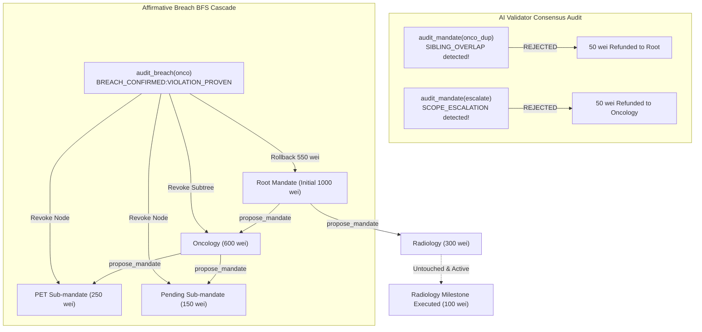

# MandateTree: Intelligent Delegation Tree with Exclusive Budget and Scope Reservations

[](https://explorer-studio.genlayer.com/address/0x18FAcCc1626F44D64B6e54eE9d1388E388d42B1d)
[](https://raw.githubusercontent.com/Kanezar3/Mandate-Tree/477bbfd28642b25a7f855d89ab1975580d0841bd/contracts/mandate_tree.py)
[](https://explorer-studio.genlayer.com/address/0x18FAcCc1626F44D64B6e54eE9d1388E388d42B1d)
[](https://explorer-studio.genlayer.com/address/0x18FAcCc1626F44D64B6e54eE9d1388E388d42B1d)

**MandateTree** is a GenLayer Intelligent Contract implementing a hierarchical delegation tree for grant distributions, organizational budgets, and multi-tier operational mandates. Delegators allocate sub-charters in natural language to delegates up to 4 levels deep. GenLayer validators utilize decentralized LLM consensus to evaluate semantic scope subsumption (child fits strictly inside parent) and exclusive partitioning (child does not conflict or overlap with active siblings). 

The contract implements **Option A: Real Native Value Transfers** via `@gl.public.write.payable` on root initialization and CEI-compliant native withdrawals via `_EoaRecipient(recipient).emit_transfer(value=amount)`.

---

## 1. Why GenLayer is Essential

Traditional smart contracts on EVM/Solidity are incapable of:
1. **Understanding Natural Language Charters**: Semantic evaluation of clinical or enterprise scopes (e.g., verifying that "PET radiotracer synthesis" is strictly inside "Translational Oncology" and completely disjoint from "External Beam Radiotherapy") requires subjective contextual reasoning.
2. **Decentralized AI Consensus without Oracles**: Rather than relying on centralized trusted oracles, GenLayer consensus validators independently execute LLM prompts against canonical JSON schemas, achieving deterministic on-chain consensus.
3. **Dynamic BFS Cascading Breach Revocation**: When an operational breach or off-charter violation is confirmed via affirmative consensus, the contract automatically traverses the subtree via Breadth-First Search (BFS), revoking all child mandates, cancelling unspent reservations, and atomically returning funds to the root principal while keeping unaffected sibling trees intact.

---

## 2. Architecture & State Lifecycle



### Key Technical Mechanisms
- **Hierarchy Bounds**: Maximum tree depth of 4 (`MAX_DEPTH = 4`), max 16 children per parent (`MAX_CHILDREN = 16`), max 64 total mandates (`MAX_MANDATES = 64`), max 128 milestones (`MAX_MILESTONES = 128`).
- **Option A Native Value Transfers**:
  - `initialize_tree(..., value=root_budget)`: marked `@gl.public.write.payable`, enforcing `gl.message.value == root_budget`.
  - `withdraw_payout(recipient)`: transfers real native wei to recipient EOA via:
    ```python
    @gl.evm.contract_interface
    class _EoaRecipient:
        def emit_transfer(self, value: u256) -> None:
            ...
    ```
- **Strict Canonical Consensus Schemas**:
  - `audit_mandate`: exact 7-field canonical JSON equality (`evidence_digest`, `exclusive_from_siblings`, `mandate_id`, `parent_id`, `reason`, `subsumed_by_parent`, `verdict`) + strict Python type checking.
  - `audit_breach`: exact 5-field canonical JSON equality (`breach_digest`, `expected_hash`, `mandate_id`, `reason`, `verdict`) + affirmative-only polarity (`BREACH_CONFIRMED:VIOLATION_PROVEN`).
- **Anti-TOCTOU Live Sibling Snapshotting**: Active siblings are snapshotted immediately before consensus closure to prevent race conditions during proposal audits.
- **Fail-Closed Evidence Fetching**: All URLs must use `https://` with whitelisted hostnames (`raw.githubusercontent.com`), maximum 2048 chars, 64-hex SHA-256 digest validation, and 100 KB payload limits.
- **Retry & Immutability Guarantees**: Transient `UNVERIFIABLE` errors allow up to 5 audit attempts (`MAX_AUDIT_ATTEMPTS = 5`). Concluded verdicts (`APPROVED`, `REJECTED`, `BREACH_CONFIRMED`, `COMPLIANT`) are strictly immutable.

---

## 3. Live StudioNet Deployment

| Parameter | Value | Explorer Link |
| :--- | :--- | :--- |
| **Contract Address** | `0x18FAcCc1626F44D64B6e54eE9d1388E388d42B1d` | [Explorer Address](https://explorer-studio.genlayer.com/address/0x18FAcCc1626F44D64B6e54eE9d1388E388d42B1d) |
| **Deploy Tx Hash** | `0xcece5d9075522fb4883b88f81d31065c97acf8c774522ffa6f66cb672492bd71` | [Explorer Tx](https://explorer-studio.genlayer.com/tx/0xcece5d9075522fb4883b88f81d31065c97acf8c774522ffa6f66cb672492bd71) |
| **Commit SHA** | `477bbfd28642b25a7f855d89ab1975580d0841bd` | [Commit 477bbfd](https://github.com/Kanezar3/Mandate-Tree/commit/477bbfd28642b25a7f855d89ab1975580d0841bd) |
| **Contract Blob Hash** | `b97722ca074b71437bf96f7aa675d093b4f8177b` | [Raw Blob](https://raw.githubusercontent.com/Kanezar3/Mandate-Tree/477bbfd28642b25a7f855d89ab1975580d0841bd/contracts/mandate_tree.py) |
| **Code SHA-256** | `a71d12d97e1879b56389de45b5b5df01644b0db9b8993d09b8321a85a426b1bb` | Exact match with on-chain deployed bytecode |
| **Probe Contract** | `0x1c19e32a0A7F34C39fF7b9fa04Fd2b24675Ef616` | [Probe Address](https://explorer-studio.genlayer.com/address/0x1c19e32a0A7F34C39fF7b9fa04Fd2b24675Ef616) |

---

## 4. Live 26-Transaction Demonstration (S1–S17 & X1–X9)

All 26 transactions have been executed and finalized on GenLayer StudioNet:

| Step | Scenario | Method | Caller | Value | Result | Explorer Link |
| :--- | :--- | :--- | :--- | :--- | :--- | :--- |
| **X1** | Unauthorized Caller initialize_tree Blocked | `initialize_tree` | Attacker | 1000 wei | `ERROR: UNAUTHORIZED_CALLER` | [`0xdb48ff...ac0a37`](https://explorer-studio.genlayer.com/tx/0xdb48ff74ea8239178dbbaa21897f4e22ea15592892497f690887caab48ac0a37) |
| **S1** | Root Tree Initialization (1000 wei Payable, 3600s Duration) | `initialize_tree` | Root | 1000 wei | `SUCCESS: TREE_INITIALIZED:root` | [`0x871d3f...0ab90e`](https://explorer-studio.genlayer.com/tx/0x871d3fa983e28d9973663f8befc55a6bb2e7c2ec0881bcae8beeb382500ab90e) |
| **X2** | Unpinned Mutable Branch URL Blocked | `propose_mandate` | Root | - | `ERROR: INVALID_EVIDENCE_URL` | [`0x6057d6...6f36bb`](https://explorer-studio.genlayer.com/tx/0x6057d6b436fc942ce52036765097d8134a3f4c3d2258a6e9d4ca4509176f36bb) |
| **X3** | Unauthorized Delegator Blocked (Strict Authority Binding) | `propose_mandate` | Attacker | - | `ERROR: UNAUTHORIZED_DELEGATOR` | [`0x97b78d...83d0ea`](https://explorer-studio.genlayer.com/tx/0x97b78db172e02c085097d7860d2385aa6485ec17dd8f13fc3738faeebf83d0ea) |
| **S2** | Propose Level-1 Mandate onco (600 wei Reserved) | `propose_mandate` | Root | - | `SUCCESS: PROPOSED:onco:PARENT_root` | [`0xcc199e...877081`](https://explorer-studio.genlayer.com/tx/0xcc199e3857be56c7a68d54066947046fa70e1b07cca2cf960d52e2db62877081) |
| **S3** | LLM Consensus Audit: onco Approved (Vertical Attenuation) | `audit_mandate` | LeadOnco | - | `SUCCESS: AUDIT_APPROVED:onco:SUBSUMED_AND_EXCLUSIVE` | [`0x6583e7...b8c19f`](https://explorer-studio.genlayer.com/tx/0x6583e789954a1c5afabb3aee2ecb89c981757ce0be0e2f2bd124439218b8c19f) |
| **X4** | Re-audit Concluded APPROVED Mandate Blocked (Immutability) | `audit_mandate` | Attacker | - | `ERROR: MANDATE_ALREADY_CONCLUDED` | [`0x77906d...0f6767`](https://explorer-studio.genlayer.com/tx/0x77906dc96421ca986dd2ab89de8e8fe3163a526a797c776c7e46d64bad0f6767) |
| **S4** | Propose Level-1 Disjoint Sibling radio (300 wei Reserved) | `propose_mandate` | Root | - | `SUCCESS: PROPOSED:radio:PARENT_root` | [`0xda1a72...f613e9`](https://explorer-studio.genlayer.com/tx/0xda1a72c011df5f78eff304606d0f490a0b2251f01d42a2cc0c6d951285f613e9) |
| **S5** | LLM Consensus Audit: radio Approved (Disjoint from onco) | `audit_mandate` | LeadRadio | - | `SUCCESS: AUDIT_APPROVED:radio:SUBSUMED_AND_EXCLUSIVE` | [`0x943e0a...f6de7a`](https://explorer-studio.genlayer.com/tx/0x943e0abf954927f7c0d46bddbaa02998ae5f77ed6e9ab8156f39338ebdf6de7a) |
| **S6** | Propose Overlapping Sibling onco_dup (50 wei Reserved) | `propose_mandate` | Root | - | `SUCCESS: PROPOSED:onco_dup:PARENT_root` | [`0x320e52...cae4c4`](https://explorer-studio.genlayer.com/tx/0x320e52fa0d0eb1fb45bd2f5c8bfa36557d6a684ad1001ed8e64b1b11b3cae4c4) |
| **S7** | LLM Consensus Audit: onco_dup Rejected (SIBLING_OVERLAP, 50 wei Refunded) | `audit_mandate` | Root | - | `SUCCESS: AUDIT_REJECTED:onco_dup:SIBLING_OVERLAP` | [`0xfd4ce7...5d8e91`](https://explorer-studio.genlayer.com/tx/0xfd4ce79f064dd8ed252bc2b9ddb88f4875c413447ed3dcc48ef11593275d8e91) |
| **S8** | Propose Out-of-Scope Level-2 onco_escalate (50 wei Reserved) | `propose_mandate` | LeadOnco | - | `SUCCESS: PROPOSED:onco_escalate:PARENT_onco` | [`0xa4a9d2...80b7c5`](https://explorer-studio.genlayer.com/tx/0xa4a9d20f1a83af9dd9ac1c9167a48b42858cf3f04deb6c7510c8cf2e8b80b7c5) |
| **S9** | LLM Consensus Audit: onco_escalate Rejected (SCOPE_ESCALATION, 50 wei Refunded) | `audit_mandate` | LeadOnco | - | `SUCCESS: AUDIT_REJECTED:onco_escalate:SCOPE_ESCALATION` | [`0x11a974...36bdfe`](https://explorer-studio.genlayer.com/tx/0x11a974cb4845a9614f565ff039ebb664c41524429a0d8d5cba0bb67f7736bdfe) |
| **S10** | Propose Valid Level-2 Mandate onco_pet (250 wei Reserved) | `propose_mandate` | LeadOnco | - | `SUCCESS: PROPOSED:onco_pet:PARENT_onco` | [`0xa8ef2b...a462ff`](https://explorer-studio.genlayer.com/tx/0xa8ef2bb1418bbfba74529884ed0d5e690c89d61ff03909a42e314dc469a462ff) |
| **S11** | LLM Consensus Audit: Level-2 onco_pet Approved (Depth 2 Active) | `audit_mandate` | SubPet | - | `SUCCESS: AUDIT_APPROVED:onco_pet:SUBSUMED_AND_EXCLUSIVE` | [`0xd0505c...661cb3`](https://explorer-studio.genlayer.com/tx/0xd0505c8bff4c33e394e409f23977090dbb19e48cbb9a5a37d33c721b97661cb3) |
| **S12** | Propose Level-2 onco_pending (150 wei Held in PENDING_AUDIT) | `propose_mandate` | LeadOnco | - | `SUCCESS: PROPOSED:onco_pending:PARENT_onco` | [`0x684b07...08174a`](https://explorer-studio.genlayer.com/tx/0x684b07147cf2e0c5858d883a966b76530bbc44e23b218f4ea3b4768ccd08174a) |
| **X5** | Untrusted Caller Treasury Draw Blocked | `execute_milestone` | Attacker | - | `ERROR: UNAUTHORIZED_DELEGATEE` | [`0xc91e6a...2ba7e0`](https://explorer-studio.genlayer.com/tx/0xc91e6ae1887963ecf27062759cce45b8fac52aeb9997c17858dc2aec1b2ba7e0) |
| **S13** | Authorized Level-2 Milestone Drawdown (50 wei) | `execute_milestone` | SubPet | - | `SUCCESS: MILESTONE_EXECUTED:onco_pet:AMOUNT_50` | [`0x3c9eca...78f547`](https://explorer-studio.genlayer.com/tx/0x3c9eca5b5fefe6cc42c1709f1960d77383a5bd2e5f3ee6d124afc81a2678f547) |
| **S14** | Strict Breach Polarity: Compliant Evidence Leaves Subtree Untouched | `audit_breach` | Attacker | - | `SUCCESS: BREACH_COMPLIANT:onco:WITHIN_SCOPE` | [`0x165f57...411fe2`](https://explorer-studio.genlayer.com/tx/0x165f57f660648f92c5cf08b158c4740be490d545c107d3a830c9764be4411fe2) |
| **X6** | Conclusive COMPLIANT Breach Replay Blocked (Immutability) | `audit_breach` | Attacker | - | `ERROR: BREACH_ALREADY_EVALUATED` | [`0x294129...e6247a`](https://explorer-studio.genlayer.com/tx/0x2941292a64789ec73c4a89e60006659b243de36793eac3a59c1e8a4f20e6247a) |
| **S15** | Affirmative Breach BFS Cascade Revocation (3 Nodes Revoked, 550 wei Rolled Back to Root; Sibling radio Untouched) | `audit_breach` | Root | - | `SUCCESS: BREACH_REVOKED:onco:NODES_3:RECLAIMED_550` | [`0x02ba67...84f76d`](https://explorer-studio.genlayer.com/tx/0x02ba67196a3e4f578eebf0273c1b81b30e2dbbc43c87fa622b8103b87b84f76d) |
| **X7** | Cascade-Revoked Descendant Milestone Draw Blocked | `execute_milestone` | SubPet | - | `ERROR: MANDATE_NOT_ACTIVE` | [`0x73627c...01d4e4`](https://explorer-studio.genlayer.com/tx/0x73627c568090c531f0a026639e821e4cc36e3233c5429b9367386ad3ca01d4e4) |
| **X8** | Revoked Branch Sub-Delegation Blocked | `propose_mandate` | LeadOnco | - | `ERROR: PARENT_NOT_ACTIVE` | [`0xb1dbb0...7f94de`](https://explorer-studio.genlayer.com/tx/0xb1dbb025efb0009211469e988be3abc05585a2cc343ec8e7d32a75a4cf7f94de) |
| **X9** | Premature Expiry Sweep Before Deadline Blocked | `sweep_expired_tree` | Attacker | - | `ERROR: TREE_STILL_ACTIVE` | [`0xe9c5f4...ec3812`](https://explorer-studio.genlayer.com/tx/0xe9c5f4c769a41d32fc71660e37942a1566c8c22a299ef7186a74e61530ec3812) |
| **S16** | Sibling Isolation Proven: Unaffected radio Executes Milestone (100 wei) | `execute_milestone` | LeadRadio | - | `SUCCESS: MILESTONE_EXECUTED:radio:AMOUNT_100` | [`0x89488e...fd40b3`](https://explorer-studio.genlayer.com/tx/0x89488e74fa11339da27073589c4a3cd6b6fc7d4c7b0c82ec986a98fd68fd40b3) |
| **S17** | Pull-Payment Real Native Withdrawal via _EoaRecipient.emit_transfer (50 wei) | `withdraw_payout` | SubPet | - | `SUCCESS: 50` | [`0x2f3ff6...dda291`](https://explorer-studio.genlayer.com/tx/0x2f3ff606f0b8ff92380bce4fcc0de3fe63a8e4a2c27e14f9a0631397e7dda291) |

---

## 5. Canonical Evidence Fixtures

All fixtures are pinned to the deploy commit and strictly verified by SHA-256 digest:

| Fixture File | Scope / Purpose | SHA-256 Digest | Raw GitHub URL |
| :--- | :--- | :--- | :--- |
| `evidence/root_charter.json` | Canonical charter/breach fixture | `ae209b0a34c7...0a68a552` | [Raw URL](https://raw.githubusercontent.com/Kanezar3/Mandate-Tree/477bbfd28642b25a7f855d89ab1975580d0841bd/evidence/root_charter.json) |
| `evidence/onco_charter.json` | Canonical charter/breach fixture | `4239d8a3c047...ac5d91b7` | [Raw URL](https://raw.githubusercontent.com/Kanezar3/Mandate-Tree/477bbfd28642b25a7f855d89ab1975580d0841bd/evidence/onco_charter.json) |
| `evidence/radio_charter.json` | Canonical charter/breach fixture | `86318249a908...43f8d541` | [Raw URL](https://raw.githubusercontent.com/Kanezar3/Mandate-Tree/477bbfd28642b25a7f855d89ab1975580d0841bd/evidence/radio_charter.json) |
| `evidence/onco_dup_charter.json` | Canonical charter/breach fixture | `ddfbec1c29dc...7bf7a589` | [Raw URL](https://raw.githubusercontent.com/Kanezar3/Mandate-Tree/477bbfd28642b25a7f855d89ab1975580d0841bd/evidence/onco_dup_charter.json) |
| `evidence/onco_escalate_charter.json` | Canonical charter/breach fixture | `7ac4343821c1...8afd8451` | [Raw URL](https://raw.githubusercontent.com/Kanezar3/Mandate-Tree/477bbfd28642b25a7f855d89ab1975580d0841bd/evidence/onco_escalate_charter.json) |
| `evidence/onco_pet_charter.json` | Canonical charter/breach fixture | `d013700bafeb...b4526715` | [Raw URL](https://raw.githubusercontent.com/Kanezar3/Mandate-Tree/477bbfd28642b25a7f855d89ab1975580d0841bd/evidence/onco_pet_charter.json) |
| `evidence/breach_compliant_audit.json` | Canonical charter/breach fixture | `031385ee861d...720daced` | [Raw URL](https://raw.githubusercontent.com/Kanezar3/Mandate-Tree/477bbfd28642b25a7f855d89ab1975580d0841bd/evidence/breach_compliant_audit.json) |
| `evidence/breach_violation_incident.json` | Canonical charter/breach fixture | `6bcfa2cb98ae...b7cbc413` | [Raw URL](https://raw.githubusercontent.com/Kanezar3/Mandate-Tree/477bbfd28642b25a7f855d89ab1975580d0841bd/evidence/breach_violation_incident.json) |

---

## 6. Local Testing & Verification

### Prerequisites
- Python 3.11+
- `genvm-lint`
- `pytest`

### Running the Test Suite
```bash
# Lint the contract
genvm-lint contracts/mandate_tree.py

# Run comprehensive test suite (8 tests covering happy paths, adversarial leader, TOCTOU, retries, and bounds)
pytest -v tests/test_mandate_tree.py
```

All 8 tests pass in < 0.4s:
- `test_full_grant_lifecycle_happy_path`: End-to-end 3-level clinical grant lifecycle with native transfers.
- `test_sibling_overlap_rejection`: AI validator consensus detects horizontal scope collision and refunds parent.
- `test_vertical_scope_escalation_rejection`: AI validator consensus detects child exceeding parent scope.
- `test_affirmative_breach_bfs_cascade`: BFS traversal revoking entire subtree and rolling back funds to root while preserving independent siblings.
- `test_unverifiable_transient_retry_and_immutability`: Up to 5 retries on transient errors; immutable final states.
- `test_adversarial_leader_tampering_rejected`: Consensus rejection when leader tampers with canonical audit payload.
- `test_anti_toctou_sibling_snapshotting`: Live sibling set snapshotting prevents race conditions during pending audits.
- `test_evidence_url_and_hash_fail_closed`: Malformed URLs and hash mismatches fail closed.

---

## 7. License
MIT License. Authored by Kanezar3.
